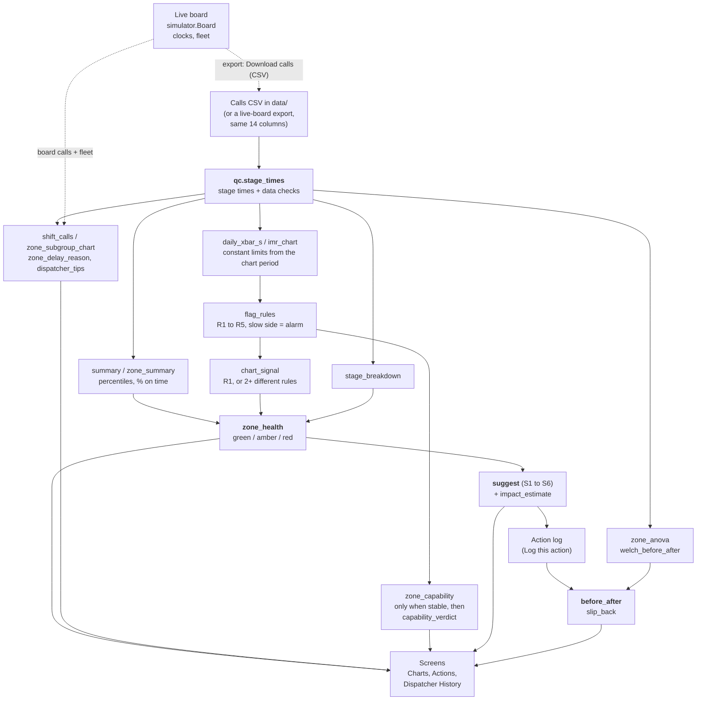

# ERGent

**A control-chart dashboard for a city 911 EMS dispatch center. Version 1.**
Team ERG (Nidhi Baderiya, Zeba Haq, Dhruv Bhandari) | Prompt: Health Systems, Emergency Response

> **About the hackathon:** this is our entry in the Cornell Six Sigma Hackathon. The event pages are in [`docs/README.md`](docs/README.md), and the submission is on [Devpost](https://six-sigma-hackathon.devpost.com).

**Contents:**
[1. What it is](#1-what-it-is) |
[2. Live app](#2-live-app) |
[3. Quick start](#3-quick-start) |
[4. What you see](#4-what-you-see) |
[5. Inputs](#5-inputs) |
[6. The statistics](#6-the-statistics) |
[7. How the pieces fit](#7-how-the-pieces-fit) |
[8. Verification](#8-verification) |
[9. Demo](#9-demo) |
[10. Deploy](#10-deploy) |
[11. Repo map](#11-repo-map) |
[12. Limits and safety](#12-limits-and-safety) |
[13. Team and credits](#13-team-and-credits)

---

## 1. What it is

ERGent logs every 911 call's five timestamps, splits each response into three stages, and shows **which zone** is slow, **which stage** is slow, and **since when**. It flags zones that need action. It suggests a fix, with the evidence. Later it checks whether the fix worked, and warns if the zone slips back.

The prompt we chose: *"Ambulance dispatch to on-scene times are varying wildly across city zones, but the 911 center only looks at monthly averages, missing fatal outliers, not where or why these failures occur."*

**Why we built it this way:**

1. Monthly averages hide slow outliers. So we use percentiles (90th, 95th) and control charts on log response times.
2. The stage split tells you *why* a call was slow: dispatcher processing, crew turnout, or travel.
3. The zone charts tell you *where* (zones A to F) and *since when* (one point per day).
4. A before/after check tells you whether a fix worked. Slip-back alerts tell you when it stops working.

**Who it is for:**

| User | When they use it | What they decide |
|---|---|---|
| **EMS operations supervisor** (primary) | At the start of each shift, and whenever a flag fires | Which zone needs attention, which stage causes it, which fix to try, and later whether the fix worked |
| **Dispatcher on shift** (secondary) | In real time | Which open call is running late right now and needs escalating |

The tool decides nothing on its own. It flags and suggests. Qualified staff decide.

The Define and Measure work (problem statement, goal, SIPOC, process map, data-quality plan) is in [`docs/six_sigma.md`](docs/six_sigma.md). This README does not repeat it.

---

## 2. Live app

LIVE URL: (added after deploy)

No login is needed. The data is synthetic. Each browser tab has its own live board.

---

## 3. Quick start

You need **Python 3.12** (the version pinned in `app/.python-version`).

**First time on a fresh clone** (run from the repo root):

```bash
git clone https://github.com/nidhibaderiya23/sixsigma.git
cd sixsigma
python3.12 -m venv .venv
.venv/bin/pip install -r app/requirements.txt
```

**Run the app (one command):**

```bash
cd app && ./testme.sh
```

Then open <http://localhost:8000>. Stop it with Ctrl+C.

**Run the tests** (from the repo root):

```bash
.venv/bin/python -m pytest tests -q
```

How `testme.sh` finds Python:

- It looks for `.venv/bin/python` at the repo root, one level above `app/`. If that file exists, it uses it.
- If not, it uses whatever `python` is on your PATH. That Python must already have the requirements installed.
- It then runs `python -m shiny run app.py --port 8000`. It works from any folder, because it changes into `app/` first.
- On Windows, run the `.sh` scripts in Git Bash or WSL.

The requirements are pinned with `==`, so a fresh install matches ours:

| Package | Version | Used for |
|---|---|---|
| `shiny` | 1.8.0 | The dashboard (Shiny for Python) |
| `pandas` | 3.0.6 | Tables |
| `numpy` | 2.5.4 | Numbers |
| `scipy` | 1.18.1 | ANOVA, Welch, Shapiro-Wilk, F and t distributions |
| `matplotlib` | 3.11.2 | Charts |
| `pytest` | 9.1.1 | Tests |

The test data is committed in `data/`. To rebuild it, run `.venv/bin/python data/make_data.py`. It uses seed 42, so a rerun gives identical files.

---

## 4. What you see

The start page has two buttons: **I'm a dispatcher** and **I'm a supervisor**. Each role gets its own screens. A **Switch role** link in the header takes you back.

### 4.1 Dispatcher (secondary user)

The dispatcher has two tabs, **Live board** and **History**. The simulation controls sit in the page header, next to **Switch role**.

| Where | What it shows | How to read it |
|---|---|---|
| **Header: simulation controls** (dispatcher screen only) | **Day** (default Sep 20), **Speed** (30x, 60x, 120x), **Start** (00:00, 06:00, 14:00, 22:00), a coral **Simulate a shift** button (it becomes **Pause**), and **Reset**. A chip shows the clock: `LIVE 1x`, `LIVE 60x`, `SIM 120x` and so on. | Simulate replays one day of the demo data on a fast clock. Calls move through the cards at the times in the file, and replayed calls are read-only. **Reset clears everything to zero:** all calls, all 12 ambulances available, Resolved empty, and the clock back to real time. |
| **Live board: counts** | Waiting, Dispatched, En route, On scene, and Units available | A quick view of the workload |
| **Numbered cards** | **1 Log a call** (zone, priority such as "1: Life-threatening", **Clock speed** 1x, 10x, 30x or 60x, **Add call**), **2 Incoming calls**, **3 Dispatched**, **4 En route**, **5 Resolved**. Each open call has a running clock. | Work a call from card 1 to card 5. The clock is green until 80% of its target, amber above that, and **red past the target**. The clock speed applies when no simulation is running: at 60x, one real second is one board minute. |
| **Poka-yoke** (mistake-proofing) | The buttons Dispatch, En route, On scene and Clear | See the list below. The wrong entry is hard to make. |
| **Ambulances** | The 12 ambulances in four columns with counts: **Available**, **Responding** (dispatched or en route), **On scene** and **Out of service**. Each shows its home zone and an **Out of service** or **Back in service** button. | "Out of service" flags that unit's open calls as a breakdown |
| **Zone map** | A schematic grid of the 6 zones (A B C on top, D E F below). Each tile shows open calls and free ambulances. | The tile takes the worst clock colour in the zone |
| **5 Resolved** (full width) | Every call that has reached the scene, with its final response time. The list scrolls and shows the latest 60. A call you logged and that is still at the scene has a **Clear** button, with a confirmation. A cleared call shows **Cleared**. Replayed calls show **At the scene** and **Replay**. | On scene counts as resolved. The time is red if the response was past its target. |
| **History** | The **current shift and the previous shift** (day 06-14, evening 14-22, night 22-06), following the board clock. It refreshes about every 5 seconds while visible. Calls, Mean, Standard deviation and On time on top. Below: one **Response time by zone** chart (about 72% of the width) with a **Priority** dropdown ("Priority 2: Urgent"), and **Suggested actions** (about 28%), each named Dispatch now, Rebalance, Cover, Route, Station alert or Dispatcher load. | A zone's box plot shows its calls. Its diamond is the zone mean. A red diamond is a zone slower than the city as a whole: **hover it** to see why. Suggestions are for the dispatcher's judgment. |

**Poka-yoke rules on the live board:**

- Only the next step works: Dispatch, then En route, then On scene, then Clear. Any other press is refused with a message.
- Dispatch needs a free unit. The picker lists only available units, with the call's home-zone units first.
- When a stage ran past its target, a dialog asks for a delay reason (one of 6 codes) before the press is accepted. The time you pressed is kept.
- Clear asks "Clear call ...?" first.
- If you mark a unit out of service, its open calls are flagged. The reason "ambulance breakdown" is recorded for you when the call reaches the scene.

### 4.2 Supervisor (primary user)

The supervisor view has two tabs, **Charts** and **Actions**. The **control bar** at the top of Charts sets what both tabs show: the chart, zone, priority, dataset, as-of date, chart period and a **Targets** button (see [section 5.3](#53-supervisor-controls-the-parameters)).

Every card has one plain title. A short **More info** toggle (2 or 3 sentences) explains it. The F value, p-values and the Ppk and Cpk numbers are only there.

| Where | Card | What it shows | How to read it |
|---|---|---|---|
| Charts | **Control chart** | One chart at a time: the **Daily chart** (X̄ and S) or **Every call** (each call, with the UCL, LCL and the amber target line) | A red dot is a day (or call) outside the normal range. Dashed grey lines are control limits. The amber line is the target. They are different lines. |
| Charts, right | **Statistics** | Average, Standard deviation, On time and Zones flagged, for the chart period and all zones | The goal is at least 90% on time. |
| Charts, right | **Zone map** | Six tiles, A to F. Red means act, amber means worth a look, green means on track. | **Hover a tile** for its reasons. |
| Charts, right | **Data quality** | The calls left out of the statistics, with the reason. It appears only when there are some. | Bad records are listed, never averaged in. |
| Charts | **Delay by stage** | Each zone's minutes over target, split into dispatch, crew turnout and travel, for the chart period | **Hover a bar** for its share, minutes over target and median. |
| Charts | **Zone comparison** | A plain answer to "do the zones really differ?" | "Yes. Zone D is typically 6.0 min against 4.9 min in Zone A..." |
| Charts | **Capability** | One plain verdict per zone (Reliable, Just meets the standard, Below the standard, Can't judge yet, Not enough calls) | "About 98 in 100 calls within 9 min." |
| Actions | **Suggested actions** | Fixed rules with evidence and an impact estimate | Every suggestion is "for review by qualified staff". |
| Actions | **Actions taken** | The action log, with **Log an action** | |
| Actions | **Before and after**, **Result** | The zone's daily chart with the action marked, and a table of Mean, Standard deviation, On time and Calls before and after, with a verdict chip | The verdict is *Improved*, *Got worse*, *No clear change yet* or *Not enough data*. |

---

## 5. Inputs

Only what the user can actually measure or already knows. The city's computer-aided dispatch system (CAD) records one row per call. **Nobody types a timestamp.** CAD stamps the call when it arrives. The dispatcher and the crew stamp the rest by pressing a button. The caller's address stays in CAD. The tool only uses the zone.

The full codebook (every file, every column, units, and what real collection would take) is in [`data/README.md`](data/README.md).

### 5.1 Columns of a calls file

| Input | Type and units | Where the user gets it |
|---|---|---|
| `call_id` | text | CAD, automatic |
| `zone` | category, A to F | CAD, from the caller's address |
| `priority` | 1 (life-threatening), 2, 3 | The call-taker's medical code in CAD |
| `call_received`, `dispatched`, `en_route`, `on_scene`, `cleared` | timestamps, to the second | CAD stamps the first. The dispatcher's and crew's buttons stamp the rest. |
| `unit_id`, `unit_home_zone` | text; A to F | CAD fleet list |
| `distance_km` | number, km | CAD's GPS routing |
| `dispatcher_id` | text | CAD login. Stored, never shown per person. |
| `weather` | clear, rain or snow | CAD weather feed |
| `delay_reason` | one of 6 codes, blank unless late | The crew taps it only when a stage runs past its target |
| Targets (settings) | seconds or minutes, per priority | NFPA 1710 defaults. The supervisor can edit them. |

The 6 delay reason codes (as written in the CSV): `traffic_or_road_closure`, `ambulance_breakdown`, `unit_from_another_zone`, `unclear_address`, `weather`, `crew_not_ready`.

### 5.2 Targets and where they come from

Each target should be met by **at least 90% of calls**. Response (dispatched to on scene) is the prompt's metric.

| Measure | P1 | P2 | P3 | Source |
|---|---|---|---|---|
| Processing (`call_received` to `dispatched`) | 64 s | 64 s | 64 s | NFPA 1710 |
| Turnout (`dispatched` to `en_route`) | 60 s | 60 s | 60 s | NFPA 1710 |
| Travel (`en_route` to `on_scene`) | 480 s | 840 s | 1140 s | P1: NFPA 1710 (advanced life support unit). P2, P3: response target minus the 60 s turnout target. |
| **Response** (`dispatched` to `on_scene`) | **540 s (9 min)** | 900 s (15 min) | 1200 s (20 min) | P1: NFPA 1710. **P2 and P3 are our own assumptions**, because NFPA does not set them. |

### 5.3 Supervisor controls (the parameters)

| Control | Choices | Default | What it does |
|---|---|---|---|
| Chart | Daily chart, Every call | Daily chart | Which control chart to show |
| Zone | A to F | D | The zone the control chart shows |
| Priority | 1: Life-threatening, 2: Urgent, 3: Non-urgent | 1 | Which calls to analyze. Each priority has its own target. |
| Dataset | Demo city (42 days), Baseline city (28 days), Messy file (3 days) | Demo | Which file to analyze |
| As of | a date in the file | 2026-10-12 (the last day of the demo file) | The "today" for every card. Later calls are ignored. It moves to the file's last day when you change the dataset. |
| Chart period | Last 14, 28 or 42 days | 28 | How much history every card uses. It is also the window that sets the control limits. |
| Targets (button) | Priority 1, 2 and 3 targets in minutes; processing and turnout targets in seconds | 9, 15, 20 min; 64 s; 60 s | The targets. Defaults: NFPA 1710 for priority 1; priorities 2 and 3 are our assumptions. |

The dispatcher's controls are: simulation day (default 2026-09-20), speed (30x, **60x**, 120x), start time (**00:00**, 06:00, 14:00, 22:00), the clock speed for calls logged by hand (**1x**, 10x, 30x, 60x), and the zone and priority of a new call. The History tab has one control, the priority of its chart.

---

## 6. The statistics

Every number on screen comes from **one plain, tested function** in [`app/qc.py`](app/qc.py). The screens only call these functions and draw the results. There is no statistics code in the UI files. Inputs, outputs and degenerate cases for each function are in the [function reference](app/README.md).

Response times are skewed: most are fast, and a few are very slow. So control charts, capability and the tests all work on the **natural log** of response minutes. A "log" is just a way to make the slow tail behave. Results are shown back in minutes.

| # | Statistic | Formula | Function in `qc.py` | Why |
|---|---|---|---|---|
| 1 | **Stage times** | processing = dispatched - call_received. turnout = en_route - dispatched. travel = on_scene - en_route. **response = on_scene - dispatched.** A call is flagged and left out if a needed timestamp is missing or out of order, its call ID is a duplicate, its response is zero, or its zone or priority is unknown. | `stage_times`, `data_issues` | Splits a delay into its stages, so we can say *why*. Bad rows never enter a statistic. |
| 2 | **Summary numbers** | mean and standard deviation (sample, n - 1), median, 90th and 95th percentile, % on time (value <= target). Percentiles use linear interpolation, "type 7": position h = (n - 1) x p on the sorted values, then x[floor h] + (h - floor h)(next - this). Same as R's default and Excel's PERCENTILE.INC. | `summary`, `percentile`, `zone_summary` | The danger is in the slow tail. The average hides it. |
| 3 | **I-MR limits** (individuals and moving range), per zone, on **ln minutes** in call order. The **Every call** chart draws the individuals part (each call, the UCL and LCL, and the target). | center = mean of the logs. sigma_short = MR-bar / 1.128. limits = center +/- 3 sigma_short. MR upper limit = 3.267 x MR-bar; lower = 0. In the app the limits come from the calls in the chart period. | `imr_limits`, `imr_chart` | Catches a single extreme delay (the "fatal outlier"). |
| 4 | **Daily X̄-S chart**, per zone (a subgroup is one zone-day), on **ln minutes**, with **constant limits** | Each day's point = the mean of that day's ln minutes. **X̄ chart:** center = the mean of the daily means in the limit window. sigma_xbar = the standard deviation of those daily means. Limits = center +/- 3 sigma_xbar, **the same for every day**. **S chart:** center s-bar = the mean of the window's daily standard deviations. Limits = s-bar x (1 +/- 3 sqrt(1 - c4^2) / c4) with c4 = c4(n-bar), n-bar = average calls per day (the B4 and B3 constants; lower never below 0). **In the app the limit window is the chart period you pick** (14, 28 or 42 days). | `daily_xbar_s`, `c4` (and `xbar_s_limits` for zone subgroups) | Shows *where* and *since when*. One window for everything keeps the chart, zone map, suggestions and capability in agreement. The cost: a problem that lasts most of the period widens the limits and can hide itself (see section 12). |
| 5 | **Flag rules R1 to R5** on the daily X̄ points (table below). A point on the **slow side is an alarm**. A point on the fast side only says "check the data". | z = (daily mean - center) / sigma_xbar, so "1 sigma" is sigma_xbar, the typical day-to-day spread of the daily means. | `flag_rules` (daily points). `imr_chart` column `beyond` (single extreme calls). | One rule alone is slow or noisy. Stacking several catches both jumps and drifts. |
| 6 | **Zone health** (green, amber, red, unknown) over the last 7 days up to the as-of date | A **chart signal** = rule R1 fired, or 2 or more different slow-side rules fired. **red** = a chart signal AND the 90th percentile is over target. **amber** = exactly one of the two. **green** = neither. **unknown** = not enough data for limits. One weaker rule alone is still drawn on the chart and noted in the reasons ("one weak signal ... keep watching"), but it does not change the status. A zone that slips back after a logged action is at least amber. | `zone_health`, `chart_signal` | One traffic light per zone, with the reason in plain words. Requiring a stronger signal keeps chance alarms rare. Red means act. |
| 7 | **Capability**, upper side only, on **ln minutes** | Ppk = (ln USL - mean of ln x) / (3 x sd of ln x), using sigma_total. Cpk is the same with sigma_short. USL is the target in minutes. Expected on time = Phi(3 x Ppk). **Shown only when the zone's daily chart (limits from the chart period) has no slow-side flag AND the zone has at least 30 calls in the period.** Otherwise: "not stable: capability is not meaningful" or "too few calls for capability (n = X; need 30)". The screen turns this into a **plain verdict**, judged on the rounded %: Very reliable (99 or more in 100 on time), Reliable (95 to 98), Just meets the standard (90 to 94), Below the standard (under 90), Can't judge yet, or Not enough calls. The Ppk and Cpk numbers sit behind More info. | `capability`, `zone_capability`, `ppk_to_pct`, `capability_verdict` | Asks "can this zone meet the target at all?". Needs a stable process, and enough calls, to mean anything. |
| 8 | **Tests**, on ln minutes, alpha = 0.05 | One-way **ANOVA** across zones: F = (SSB / (k - 1)) / (SSW / (N - k)). **Welch's t-test**, one-sided, before vs. after an action: t = (mean_b - mean_a) / sqrt(s_b^2 / n_b + s_a^2 / n_a), with Welch-Satterthwaite df and p = P(T > t). | `anova_zones`, `zone_anova`, `welch_before_after` | Do zones really differ? Did response time really drop after the fix? |
| 9 | **Normality check** | Shapiro-Wilk W and p on ln minutes, plus a normal probability plot. | `normality` | Checks the assumption behind rows 3 to 8. |
| 10 | **Stage breakdown** | stage excess = max(0, stage time - stage target), summed over calls. A stage's share = its excess / the zone's total excess. Also the median seconds per stage. | `stage_breakdown` | Shows which stage causes the minutes over target. |
| 11 | **Impact estimate** | Recount % on time with the flagged stage capped at the citywide median for that stage and priority. Example: turnout [3, 1, 4, 1] min and travel [7, 7, 6, 9] min with a 9-minute target and a 1-minute city median: on time goes from 1/4 = 25% to 3/4 = 75%. | `impact_estimate` | Puts a number on "if this stage were typical". It is an estimate, not a promise. |
| 12 | **Suggestion rules S1 to S6** (table below) | Fixed if-then rules on stage shares, delay-reason codes and counts. Each shows its evidence and says "for review by qualified staff". | `suggest` | Turns a flag into something to try. |
| 13 | **Before/after and slip-back** | Before/after: the 14 days before an action vs. the days from it on (up to 14), Welch one-sided on ln minutes. Verdict: *improved* if p < 0.05, *got worse* if p > 0.95, else *no clear change yet*. Slip-back: rebuild limits from the first 7 days after the action. Any later slow-side flag raises an alert. | `before_after`, `slip_back` | Did the fix work, and does it hold? |
| 14 | **Dispatcher shift tools** (History tab) | **Shift window:** the current 8-hour shift and the one before. **Zone chart:** each zone is one subgroup of ln response minutes (calls that reached the scene). Center = mean of the zone means. sigma_short = sqrt(mean of the zone variances). A zone's limits = center +/- 3 sigma_short / sqrt(n_zone). A zone beyond its limit is slower (or faster) than the city as a whole. **Tips T1 to T6** (table below). | `shift_window`, `shift_calls`, `zone_subgroup_chart`, `dispatcher_tips` | Shows the dispatcher where the city is slow right now, and what to do about it. |

**The five flag rules** (R1 to R4 are the Western Electric rules; R5 is a trend rule). The ids carry a `+` on the slow side and a `-` on the fast side, for example `R2+`.

| Rule | Fires when |
|---|---|
| R1 | 1 point is beyond 3 sigma |
| R2 | 2 of the last 3 points are beyond 2 sigma, on the same side |
| R3 | 4 of the last 5 points are beyond 1 sigma, on the same side |
| R4 | 8 points in a row on the same side of the center line |
| R5 | 6 points in a row steadily rising (or falling) |

Two more flags: **rule 1 on single calls** in the I chart (an extreme delay), and a **spec flag** when a zone's 90th percentile over the last 7 days is above its target. The spec flag is the second half of the red test in row 6.

**The six suggestion rules.** A stage's *share* is its excess divided by the zone's total excess. The window is the 14 days up to the as-of date. S1 to S3 apply only to zones that are amber or red.

| Rule | If | Then suggest |
|---|---|---|
| S1 | Turnout share is 50% or more | Review crew readiness at that zone's station (names a shift when that shift holds 40% or more of the zone's turnout excess **and** at least 1.5 times its share of the calls) |
| S2 | Travel share is 50% or more, 30% or more of late calls are coded "unit from another zone", and the zone borrows units at least 1.5 times the city rate | Consider posting an extra ambulance in the zone during the busiest 3 hours |
| S3 | Travel share is 50% or more, and "traffic or road closure" is the top code (at least 3 calls and 30% of late calls) | Check road works and alternative routes |
| S4 | Citywide: in an hour with above-median calls, the processing 90th percentile is over 64 s | Add dispatcher cover in that window |
| S5 | One ambulance has 2 or more breakdowns in the window | Schedule preventive maintenance for that ambulance |
| S6 | A zone has at least 5 late calls and 20% or more of them have an "unclear address" | Use an address-verification script |

**The six dispatcher tips** (History tab). They use the last two shifts and the live board, and they are for the dispatcher's judgment.

| Tip | If | Then suggest |
|---|---|---|
| T1 Dispatch now | A call on the board has waited longer than the processing target (64 s) | Dispatch it now. Names the nearest free ambulance: its own zone first, then a neighboring zone |
| T2 Rebalance | A zone has no free ambulance and a neighbor has 2 or more | Move one to stand by in that zone |
| T3 Cover | An ambulance is out of service | Ask the neighboring zones to cover that zone's calls |
| T4 Route | A zone's median travel is at least 1.25 times the city's (3 or more calls) | Depending on the top delay reason, named only when 2 or more late calls share it: reroute around traffic or road works, or keep an ambulance posted. Otherwise: check the route |
| T5 Station alert | A zone's median turnout is over the turnout target (3 or more calls) | Alert that zone's station |
| T6 Dispatcher load | The city's 90th percentile of processing is over the target (5 or more calls) | Ask the supervisor for a second dispatcher |

**Which methods come from the course, and which go beyond it.**

| From the course ([textbook](https://timothyfraser.com/sigma/)) | Beyond the course (our additions) |
|---|---|
| X̄-S chart, I-MR chart, Cpk and Ppk, one-way ANOVA | Western Electric run rules (R1 to R4), the trend rule (R5), the Shapiro-Wilk normality test, Welch's t-test, type 7 percentiles, and the log transform |

**References:**

- Course textbook for X̄-S, I-MR, Cpk/Ppk and ANOVA: <https://timothyfraser.com/sigma/>.
- Montgomery, D. C., *Introduction to Statistical Quality Control* (Wiley): control charts, the constants c4, d2 (1.128) and D4 (3.267), and capability.
- Western Electric Company (1956), *Statistical Quality Control Handbook*: the run rules.
- Nelson, L. S. (1984), "The Shewhart control chart: tests for special causes," *Journal of Quality Technology* 16(4): the trend rule.
- Shapiro, S. S. and Wilk, M. B. (1965), "An analysis of variance test for normality," *Biometrika* 52: the normality test.
- Welch, B. L. (1947), "The generalization of 'Student's' problem when several different population variances are involved," *Biometrika* 34: the unequal-variance t-test.
- Hyndman, R. J. and Fan, Y. (1996), "Sample quantiles in statistical packages," *The American Statistician* 50(4): the "type 7" percentile.
- NFPA 1710 benchmarks, as quoted by agency reports: see the references in [`docs/six_sigma.md`](docs/six_sigma.md).

**Try it in Python** (from the repo root):

```python
from app import qc

calls = qc.load_calls("data/calls_demo.csv")            # read the CSV, parse the timestamps
stages = qc.stage_times(calls)                          # add stage times and the data checks
print(qc.zone_summary(stages, priority=1))              # median, 90th, 95th percentile, % on time per zone
health = qc.zone_health(stages, priority=1, as_of="2026-09-28")
print(health[["zone", "status", "reasons"]])            # Zone D is red, with the reason
```

---

## 7. How the pieces fit



Read it left to right. Calls come in as a CSV. `qc.stage_times` is the front door: nothing else touches raw rows. Every other function reads its output. Health combines the chart signal (from the rules) and the 90th percentile. Suggestions come from health plus the stage shares. A logged action feeds the before/after check and the slip-back watch. The screens only draw the results. The live board has its own logic in `app/simulator.py`. It reads only the targets and reason codes from `qc`. The dispatcher's History tab feeds the board's calls and fleet, and the demo file, through the shift tools in `qc`.

---

## 8. Verification

Every statistic has a **known-answer test** (worked by hand in [`SPEC.md`](SPEC.md) section 4) and a **degenerate-case test**. The tests live in [`tests/`](tests).

**Known answers the tests reproduce:**

| Statistic | Input | Answer |
|---|---|---|
| Summary | response minutes [4, 5, 6, 7, 8, 9, 10, 11, 12, 20], target 9 | mean 9.2, median 8.5, 90th percentile 12.8, 95th percentile 16.4, on time 6/10 = 60% |
| I-MR | [10, 12, 11, 15, 12] | MR-bar 2.5, center 12, sigma_short 2.2163, limits 5.351 to 18.649, MR upper limit 8.1675 |
| X̄-S | subgroups [2, 4, 6], [3, 5, 7], [4, 6, 8] | x̄̄ = 5, sigma_short = 2, X̄ limits 1.536 to 8.464, c4(3) = 0.8862, S center 1.7725, S upper 4.552, S lower 0 |
| Ppk | [6, 7, 8, 9, 10], USL 12 | sd 1.5811, Ppk = 0.8433 |
| ANOVA | A = [1, 2, 3], B = [4, 5, 6] | SSB 13.5, SSW 4, F = 13.5 (df 1 and 4) |
| Welch | before [10, 12, 14], after [6, 8, 10] | t = 2.449, df = 4 |
| Impact | turnout [3, 1, 4, 1] min, travel [7, 7, 6, 9] min, target 9, city median turnout 1 min | on time 25% to 75% |
| Flag rules | center 0, sigma 1 | [0.5, 2.5, 0.3, 2.4] fires R2 at the 4th point. Eight points of 0.1 fire R4 at the 8th. [1, 2, 3, 4, 5, 6] fires R5 at the 6th. |

**Degenerate cases the tests cover:**

- **Constant data** has no spread, so the limits, Ppk, ANOVA and Welch return `None` with the message "no variation". This includes values that differ only in the last floating-point bit.
- **One call:** the percentiles equal that value. The I-MR refuses (it needs at least 2).
- **A day with one call** gets an X̄ point but no S point.
- **Missing or out-of-order timestamps, duplicate IDs, zero response, unknown zone or priority:** the call is excluded and listed. An excluded call can never move a window.
- **A group with one value** is dropped from ANOVA. Welch needs 2 or more values on each side.

An independent fresh-context review (a reviewer with no memory of the build) checked every statistic against `SPEC.md` and passed it. It led to two fixes that now have their own tests: constant data with floating-point noise, and invalid calls moving the windows. The task ledger is [`CONTRACT.yaml`](CONTRACT.yaml).

**Run the tests yourself** (from the repo root):

```bash
.venv/bin/python -m pytest tests -q
```

Output on our machine (Python 3.12.15):

```text
........................................................................ [ 93%]
.....                                                                    [100%]
77 passed in 0.95s
```

That is 49 tests of `qc.py` (`tests/test_qc.py`) and 28 tests of the live-board logic (`tests/test_simulator.py`).

The daily chart's constant limits have their own tests: the limits are the same on every day, the center and sigma come from the window's daily means, and the S chart uses the textbook B4 constant (2.568 for 3 calls a day). Zone health is tested to follow the chart period. `xbar_s_limits` still passes the SPEC section 4 X̄-S known answer above, because the zone chart and Cpk still use it.

**The messy file.** `data/calls_messy.csv` (61 rows) is built with missing en-route stamps, out-of-order times, a duplicate call ID and a zone with almost no calls. In the app, pick **Messy file** in the supervisor's Dataset menu. The **Data quality** card lists the 7 planted defects, each with its reason, and zones with too few calls show "Not enough data" on the zone map. Nothing crashes. You can also check it from Python:

```python
from app import qc

stages = qc.stage_times(qc.load_calls("data/calls_messy.csv"))
print(qc.data_issues(stages))                  # every excluded call, with the reason
print(qc.zone_summary(stages, priority=1))     # statistics on the calls that passed
```

---

## 9. Demo

The full walkthrough, with exact clicks, numbers and "how to read this" for each dataset, is in [`demo/README.md`](demo/README.md).

The five-step story on the demo city (Zone D's night-shift turnout gets slower from Sep 15; a fix is logged on Sep 29):

1. **Supervisor, as of Sep 28.** Pick **I'm a supervisor** (Demo dataset, Priority 1) and set **As of** to 2026-09-28. On **Zone map**, **Zone D is amber** ("Worth a look"). Hover it: its 90th percentile is 10.2 min against the 9-min target, and turnout causes 99% of its minutes over target. The other zones are green.
2. **Charts.** Zone D's daily chart shows **no red dots**. That is the trade-off of using the chart period as the limit window: D's slowdown (from Sep 15) is inside the window, so it widens the limits and hides itself. The other cards still show it. **Delay by stage** says 92% turnout. **Capability** says D is *Below the standard* (only about 89 in 100 calls within 9 min). **Zone comparison** says D is typically 6.0 min against 4.9 min in Zone A.
3. **Actions.** The suggestion **"Review crew readiness at Zone D's station, especially the night shift"** appears with its evidence and an impact estimate (on time rises from about 78% to about 97% if turnout were typical). Log it. (The demo's fix is already in the log as A1, dated Sep 29.)
4. **Set As of to 2026-10-12.** **Result** for A1 says **Improved**: mean 7.2 to 5.5 minutes, on time 78% to 97%. Zone D is green on the map.
5. **Dispatcher.** Click **Switch role**, then **I'm a dispatcher**. In the header, pick Sep 16, 120x and a 06:00 start, then press **Simulate a shift**. Watch calls move through the numbered cards. Open **History**, and at about 06:46 on the simulated clock pick **Priority 2: Urgent**. Zone D is a red diamond: hover it to see why (crew turnout, crew not ready). **Reset** puts everything back to zero.

---

## 10. Deploy

The app follows the course's **four-script contract**. All four files are in [`app/`](app):

| File | Job |
|---|---|
| `testme.sh` | Run the app locally on port 8000 |
| `manifestme.sh` | Copy `data/*.csv` into `app/data/` and write `manifest.json` for Posit Connect |
| `deployme.sh` | Publish to Posit Connect from your own machine |
| `README.md` | The [function reference](app/README.md) |

**Deploy with GitHub Actions** ([`.github/workflows/deploy-shiny-py.yml`](.github/workflows/deploy-shiny-py.yml), with `APP_DIR: app`):

1. On your own machine, run `cd app && ./manifestme.sh`. It copies `data/*.csv` into `app/data/` and writes `app/manifest.json`.
2. Commit `app/manifest.json` and `app/data/`, then push to `main`. A push to `main` that changes Python files, `requirements.txt`, the manifest or `.python-version` starts the workflow. You can also start it by hand (`workflow_dispatch`).
3. The workflow checks the committed manifest (it never regenerates it), sets up Python from `app/.python-version` (3.12), installs the requirements and imports the app as a smoke test, checks that both secrets exist, publishes the bundle to Posit Connect, and then checks that the front page answers HTTP 200.

**Secrets:** add `CONNECT_SERVER` and `CONNECT_API_KEY` as **GitHub repo secrets** (Settings, Secrets and variables, Actions). **Never put them in a file.** `deployme.sh` reads them from your shell, or from an untracked `app/.env`, which `.gitignore` excludes.

**Two things to remember:**

- Re-run `manifestme.sh` and commit the result after you change app code, requirements or data. The workflow ships exactly the files the manifest lists.
- A change to `app/data/` alone does not start the workflow (only code, requirements, manifest and `.python-version` changes do). Start it by hand from the Actions tab.
- Once `app/data/` exists, the app reads it first and the repo's `data/` second. If you rebuild `data/`, re-run `manifestme.sh` so the copy matches.

---

## 11. Repo map

| Path | What is in it |
|---|---|
| [`README.md`](README.md) | This file |
| [`SPEC.md`](SPEC.md) | What the tool is, the formulas and the hand-worked known answers. If the code and the spec disagree, the code is the bug. |
| [`CONTRACT.yaml`](CONTRACT.yaml) | The task ledger (H-01 to H-08) |
| [`app/`](app) | The tool. `qc.py` holds every statistic. `charts.py`, `simulator.py`, `ui_dispatcher.py`, `ui_supervisor.py` and `app.py` draw and wire it. The four scripts and the [function reference](app/README.md) are here. |
| [`data/`](data) | Synthetic CSVs (`calls_baseline`, `calls_demo`, `calls_messy`, `actions_demo`, `units`), the seeded generator `make_data.py`, and the codebook [`data/README.md`](data/README.md) |
| [`tests/`](tests) | `test_qc.py` (statistics) and `test_simulator.py` (live board) |
| [`demo/`](demo) | The demo walkthrough, [`demo/README.md`](demo/README.md) |
| [`docs/`](docs) | [`plan.md`](docs/plan.md) (tasks and suggestion rules), [`six_sigma.md`](docs/six_sigma.md) (Define and Measure), [`criteria.md`](docs/criteria.md) (the rubric), and the event pages |
| [`.github/`](.github) | The deploy workflow and its publish script |
| `demos/` | The instructor's starter templates, including the README guide we followed |

---

## 12. Limits and safety

- **Synthetic data.** Every CSV is invented by a seeded script. There is no real patient data, address or name.
- **Flags are for qualified staff.** They are for staff to investigate, not automatic dispatch decisions. The tool flags and suggests. It never dispatches or changes staffing. Every suggestion says "for review by qualified staff", and the dispatcher's tips say they are for the dispatcher's judgment.
- **Amber means "worth a look". Red means "act".** Several rules plus a 90th-percentile check will sometimes fire by chance. We count a chart signal only when rule R1 fires or 2 or more different rules fire in the last 7 days. On a pure-noise simulation, a stable zone-week then shows amber by chance about 2.5% of the time, versus 7.7% if any single rule counted. Red needs a chart signal *and* a 90th percentile over target, so it is rarer still.
- **P2 and P3 targets are our assumptions.** NFPA 1710 does not set them. The NFPA numbers are quoted from agency reports, not read from the standard. All targets are editable.
- **Control limits come from the chart period.** That keeps the daily chart, the zone map, the suggestions and the capability card in agreement, and it is simple. But a problem that lasts most of the period widens the limits and can hide itself. On the demo city, as of Sep 28 with a 28-day period, Zone D's daily chart shows no red dots. The zone map (D is amber from its 90th percentile), the capability card (D is below the standard) and the zone comparison still show it. Read the daily chart together with those cards.
- **Assumptions behind the statistics:** log response times are roughly normal (the Zone comparison card has a probability plot in More info). Calls in time order are roughly independent (stated, not tested). The chart period is mostly normal days. Capability needs stability, so it is hidden for flagged zones.
- **A better time after a fix does not prove the fix caused it.** The check shows an apparent change. Staff judge the cause.
- **Button-press timing is not validated.** A crew may press "on scene" a little after arriving. The times are only as good as the pressing habit.
- **Out of scope:** logins, a database, real maps or GPS, forecasting, AI-written suggestions, per-person dispatcher rankings, and a board shared across browsers (each browser session has its own).

More on assumptions and limits: [`docs/six_sigma.md`](docs/six_sigma.md), section 8.

---

## 13. Team and credits

- **Team ERG:** Nidhi Baderiya, Zeba Haq and Dhruv Bhandari. Cornell Six Sigma Hackathon, Oct 16 to 17, 2026, in the course SYSEN 5300.
- **Built with an AI coding agent** (Claude Code), as the event encourages. The team reviewed the work and can explain every number the tool prints.
- **Starter repo and course:** the event, the templates and the textbook are by Timothy Fraser, [timothyfraser/sixsigmahackathon](https://github.com/timothyfraser/sixsigmahackathon) (MIT license, see [`LICENSE`](LICENSE)). The deploy workflow pattern is adapted from his `fastapi-connect-demo`.
