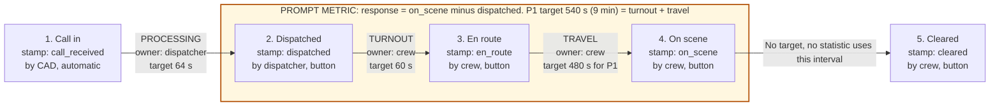

# ERGent: Six Sigma Define and Measure

Team ERG (Nidhi Baderiya, Zeba Haq, Dhruv Bhandari) | Cornell Six Sigma Hackathon, SYSEN 5300 | Prompt: Health Systems, Emergency Response

This page is the **Define** and **Measure** work for ERGent, a dashboard for the 911 EMS dispatch center of Ithaca, NY (from version 2; version 1 used an unnamed city). Section 7 shows where the app does **Analyze, Improve and Control**. Numbers and rules match [`SPEC.md`](../SPEC.md) and [`plan.md`](plan.md). If this page and `SPEC.md` ever disagree, `SPEC.md` wins.

| Term | Meaning |
|---|---|
| CAD | The city's computer-aided dispatch system. It keeps one row per call. |
| P1, P2, P3 | Call priority. P1 is life-threatening. |
| CTQ | Critical to quality: a measurable need of the customer. |
| 90th percentile | The time 90% of calls beat. The slowest 10% are above it. |
| Upper and lower control limits | Lines computed from the process itself (center ± 3 standard errors). A point outside them is not normal for that zone. Do not confuse them with the **specification limit**, a target set by a standard or the customer, such as 9 minutes. |
| Stable | Consistent over time: points stay inside the control limits and no flag fires. |
| σ_short, σ_total | Spread within each day, and spread over the whole period. Drift between days makes σ_total bigger. |
| Cpk, Ppk | Capability indices. Cpk uses σ_short (what a stable zone could do). Ppk uses σ_total (what it is doing, drift included). |
| Poka-yoke | Mistake-proofing: the screen makes the wrong entry hard to make. |

## 1. Project charter

### 1.1 Problem statement

> "Ambulance dispatch to on-scene times are varying wildly across city zones, but the 911 center only looks at monthly averages, missing fatal outliers, not where or why these failures occur. Design a statistical tool to help manage dispatchers, response time logging in real-time, generate analyzes, and flag zones that are in need of resolution."

In our words: a supervisor cannot see **which zone** is slow, **which stage** of the call is slow, or **since when**. The monthly average hides all three.

### 1.2 Business case

- **An average hides the slow tail.** Take 10 response times in minutes: 4, 5, 6, 7, 8, 9, 10, 11, 12, 20 (the hand-worked example in `SPEC.md` section 4). The mean is 9.2 minutes, close to a 9-minute target. But only 6 of the 10 calls were on time, the 90th percentile is 12.8 minutes, and one patient waited 20.
- **Six zones blend into one number.** A slow zone is diluted by five healthy ones. A month is also too late: supervisors use the tool at the start of each shift and whenever a flag fires, and dispatchers see a late open call right now.
- **For P1 calls a miss means a patient who waited.** The prompt calls these "fatal outliers".
- **What the tool adds:** live logging of every call's times, percentiles and control charts that show the slow outliers, a split of each delay into stages (the "why"), a daily chart per zone (the "where" and "since when"), and a check that a fix worked.

### 1.3 Goal

| Goal | Measure | Target |
|---|---|---|
| Process goal (the CTQ target) | P1 calls on scene within 9 minutes of dispatch | At least 90% of calls, **in every zone** (A to F). Same as: 90th percentile of 9 minutes or less. |
| Tool goal | Supervisor can name the zone, the stage and a fix to try, then check if it worked | Delivered by the Sat Oct 17, 1 PM ET submission |
| Tool goal | Dispatcher sees a late open call as it happens | Running clock turns red past its target |

### 1.4 Scope

| In scope | Out of scope (`SPEC.md` section 9) |
|---|---|
| 6 zones (A to F), priorities 1 to 3 | Logins, databases, real customer data |
| Live logging of five timestamps per call | Automatic dispatching or staffing changes: the tool flags and suggests only |
| Stage times (processing, turnout, travel); response = dispatch to on scene | Real patient data, addresses or names; hospital, on-scene care or pre-arrival instruction times |
| Dispatcher and supervisor screens | A board shared across browsers (each browser has its own live board) |
| Control charts, capability, tests, suggestions, action log | GPS or official EMS districts (the 6 zones are illustrative areas drawn on a map of Ithaca) |
| Synthetic data made by a seeded script | Per-person dispatcher rankings (the ID is stored; stats are by shift and workload) |
| | AI-written suggestions, forecasting; Pareto, fishbone and stratification screens (dropped Oct 16) |

### 1.5 Team and roles

| Who | Role |
|---|---|
| Team ERG: Nidhi Baderiya, Zeba Haq, Dhruv Bhandari | Define the problem, own the statistics and the tool, review every number. Task owners are in `CONTRACT.yaml`. |
| AI coding helpers (Claude) | Draft data, code and docs under the team's review. The team must be able to explain every number the tool prints. |
| EMS operations supervisor (primary user), dispatcher on shift (secondary user) | Supervisor decides which zone needs attention and which fix to try. Dispatcher escalates open calls that run late. |
| Ambulance crews, call-takers | Crews press the en route, on scene and cleared buttons and tap a reason code when a stage runs late. Call-takers set the priority code. |

### 1.6 Timeline

On-campus 24-hour event, **Fri Oct 16 to Sat Oct 17, 2026**.

| When | What |
|---|---|
| Fri Oct 16, from 17:53 | Plan started. Team decisions approved Oct 16. |
| Order of work (estimates from `plan.md`) | SPEC 30 min. Data and codebook 60 min. Statistics first (`app/qc.py`, one known-answer test per function) 3 h. Tool in layers 4 h: L1 role picker and dispatcher board, L2 supervisor Charts (with the Overview merged in), L3 Actions and Control. Deploy right after L1, 1 h. Demo walkthrough 45 min. Docs 60 min. Fresh-clone check 20 min. L3 is cut first if time runs short. |
| **Sat Oct 17, 1 PM ET** | Devpost submission: repo link plus a demo. Showcase 2 to 3 PM. |

## 2. Voice of the customer and the CTQ tree

We have not interviewed callers or crews. The needs below come from the prompt, from NFPA 1710 and from how EMS works. They are our reading, not survey results. Each time target is met by at least 90% of calls (the 90th percentile is at or under the target).

| Need (who) | Driver | CTQ (what we measure) | Target |
|---|---|---|---|
| Help arrives fast and at the right place (patient or caller) | Short time from dispatch to arrival | **Response time**, dispatched to on scene (the prompt's metric) | P1: 540 s (9 min). P2: 900 s (15 min), P3: 1200 s (20 min). P2 and P3 are our assumptions. |
| ...so the call is not held up before dispatch | Call taken and coded quickly | Processing time, call received to dispatched | 64 s (NFPA 1710) |
| ...so the crew leaves quickly | Crew ready to roll | Turnout time, dispatched to en route | 60 s (NFPA 1710) |
| ...so the drive is short | Good unit choice and route | Travel time, en route to on scene | P1: 480 s (NFPA 1710, advanced life support). P2: 840 s, P3: 1140 s (response target minus 60 s). |
| Same service in every zone (patient, supervisor) | No zone drifts, and no slow tail | % on time per zone; daily chart flags per zone; zone differences (ANOVA) | At least 90% on time in each zone; no flags |
| Know where, why and since when; know if a fix worked (supervisor) | Stage split, daily zone chart, before/after check | Stage excess; flags; action log | Each flag shows its stage and evidence |
| Know a call is late now (dispatcher) | Live clock on each open call | Running clock per status | Red past the target |

Why the 90th percentile and not the average? The average blends fast and slow calls. The 90th percentile looks at the slow tail, which is where the danger is.

## 3. SIPOC

| Suppliers | Inputs | Process step | Outputs | Customers |
|---|---|---|---|---|
| Caller; call-taker; CAD | 911 call; address (becomes the zone); medical priority code | 1. Receive and code the call (**processing**) | `call_received` stamp, `zone`, `priority` | Dispatcher |
| Dispatcher; CAD fleet list; CAD GPS routing | Open call; available ambulances with home zone; route distance | 2. Pick a unit and dispatch it | `dispatched` stamp, `unit_id`, `unit_home_zone`, `distance_km` | Ambulance crew |
| Ambulance crew | Dispatch order | 3. Crew gets ready and leaves (**turnout**) | `en_route` stamp; reason code if late | Crew, supervisor |
| Ambulance crew; roads; CAD weather feed | Unit on the road; weather | 4. Drive to the scene (**travel**) | `on_scene` stamp; reason code if late | **Patient**, supervisor |
| Ambulance crew | Unit at the scene | 5. Finish and clear | `cleared` stamp; call moves to Resolved | Dispatcher, supervisor |
| Team ERG; NFPA 1710 | The call records; targets (editable by the supervisor) | 6. ERGent turns records into stage times, charts, flags and suggestions | Zone health, flags, suggestions with evidence, action log | **EMS operations supervisor** |

## 4. Process map

- The prompt's metric is the highlighted box: **dispatched to on scene**.
- Processing happens before dispatch, so it sits outside the prompt's metric. We still measure it, because a delay there also hurts the patient.
- Response = turnout + travel, and the travel target is the response target minus the turnout target. So a late call always has a late turnout, a late travel, or both. That is how the stage split finds "why".

## 5. Operational definitions

Timestamps are to the second. Response times are shown in minutes.

| Timestamp | The moment | Stamped by |
|---|---|---|
| `call_received` | The 911 call arrives in CAD | CAD, automatic |
| `dispatched` | The dispatcher sends an ambulance to the call | Dispatcher, button |
| `en_route` | The crew leaves for the scene | Crew, button |
| `on_scene` | The ambulance arrives at the address | Crew, button |
| `cleared` | The crew finishes and the call is resolved | Crew, button |

Each stage is the later stamp minus the earlier stamp.

| Stage | Formula | Target, P1 | P2 | P3 |
|---|---|---|---|---|
| Processing | `dispatched` - `call_received` | 64 s | 64 s | 64 s |
| Turnout | `en_route` - `dispatched` | 60 s | 60 s | 60 s |
| Travel | `on_scene` - `en_route` | 480 s | 840 s | 1140 s |
| **Response** (prompt metric) | `on_scene` - `dispatched` | **540 s (9 min)** | 900 s (15 min) | 1200 s (20 min) |

Travel target = response target - 60 s turnout target (`qc.stage_targets`). All targets are editable by the supervisor. P2 and P3 response targets are our own assumptions.

- A **late call** has a response time **greater than** its priority's response target. On time means at or under it.
- A **late stage** has a stage time greater than that stage's target. The crew taps a delay reason only when a stage is late.
- A **defect** is a late call. One call is one opportunity. Calls that fail a data check (6.2) are left out, so they are neither defects nor successes.
- The 9-minute target is a **specification limit**. Control limits come from the zone's own baseline data. They are different lines, and the tool never mixes them.
- **Shifts** (by the hour the call is received): day 06 to 14, evening 14 to 22, night 22 to 06.
- **Zone-day**: all of one zone's calls received on one calendar day. It is the subgroup for the daily chart.

## 6. Measure: data and data quality

### 6.1 Where each field comes from

Nobody types a timestamp. That is the first mistake-proof.

| Field | Source | How |
|---|---|---|
| `call_id`, `zone`, `priority` | CAD | Automatic. Zone comes from the caller's address, priority from the call-taker's medical code. The tool keeps only the zone, not the address. |
| `call_received` | CAD | Auto-stamp when the call arrives |
| `dispatched`, `en_route`, `on_scene`, `cleared` | CAD | Dispatcher's and crew's button presses |
| `unit_id`, `unit_home_zone`, `weather` | CAD fleet list, CAD weather feed (clear, rain, snow) | Automatic |
| `distance_km` | CAD GPS routing | Automatic. The tool has no map or GPS of its own. |
| `dispatcher_id` | CAD login | Stored. Never shown per person. |
| `delay_reason` | Crew | Tap one of 6 codes, only when a stage runs past its target: traffic or road closure, ambulance breakdown, unit from another zone, unclear address, weather, crew not ready |
| Targets | NFPA 1710 defaults | Supervisor can edit |

### 6.2 Data checks the tool runs

A call that fails a check is **listed with its reason and left out of every statistic**. The tool must not crash on bad rows.

| Check | Example | Result |
|---|---|---|
| Duplicate call ID | The same `call_id` appears twice | The repeat is listed and excluded |
| Missing timestamp | No `en_route` stamp | Listed and excluded |
| Out-of-order timestamps | `en_route` earlier than `dispatched` | Listed and excluded |
| Unknown zone or priority | Zone "G", or priority 4 | Listed and excluded |

Edge cases: the I-MR chart needs at least 2 calls. A day with 1 call gets an average point but no standard-deviation point. Constant data has zero spread, so limits and capability say "no variation". `data/calls_messy.csv` (about 60 calls) is built to show these: missing en-route stamps, out-of-order times, a zone with 2 calls, a day with no calls and a duplicate call ID.

### 6.3 Mistake-proofing at the source (poka-yoke)

| Mistake | How it is blocked |
|---|---|
| Stamping steps out of order | Buttons only work in order |
| A late stage with no explanation | A reason code is required when a stage is late |
| Free-text reasons that cannot be counted | One of 6 fixed codes, blank unless late |
| Mistyped times, zones or IDs | Times, zone and dispatcher ID come from CAD, not from typing |
| Closing a call by accident | Clear asks for confirmation first |

The data checks in 6.2 are the second line of defense for what still gets through.

### 6.4 Baseline period

- **Default baseline: the first 14 days.** The supervisor can move the baseline dates.
- Control limits come from this baseline, not from the whole series. If a problem starts on day 15 and the limits were built from all the days, the problem would stretch the limits and hide itself. Limits from calm days stay put, so a new slowdown shows up as a flag.
- We assume the baseline is stable. The tool shows the baseline chart so the supervisor can check.
- After an action is logged, slip-back alerts judge new points against the after-action limits (7.3).
- `calls_baseline.csv` is 28 stable days. `calls_demo.csv` is 42 days: Zone D's night-shift turnout rises from day 15 (fix logged day 29), and Zone C's weekday 4 to 7 PM travel slows from day 20 (road works).

## 7. Analyze, Improve and Control in the app

| Phase | Question | Screen | Statistic (in `app/qc.py`) |
|---|---|---|---|
| **Define** | What is the problem, goal, scope? | No screen: this page (the team put Define and Measure in the docs) | Charter, CTQ tree, SIPOC |
| **Measure** | What do we record, and can we trust it? | Dispatcher: live tables with running clocks, ordered buttons, reason codes, fleet board, history tab. Supervisor: Charts statistics (average, standard deviation, % on time) and zone map | `stage_times` (stages, data checks); `summary` (mean, standard deviation, percentiles, % on time) |
| **Analyze** | Which zone, which stage, since when, is it real? | Supervisor: Charts (zone map, control charts) | `imr_chart` (every call), `daily_xbar_s` (daily X̄-S, limits from the chart period), `flag_rules`, stage breakdown, `capability`, `anova_zones`, `welch_before_after` (7.1) |
| **Improve** | What should we try, and what would it gain? | Supervisor: Actions, suggestions | `suggest` and `impact_estimate` (7.2) |
| **Control** | Did the fix work, and does it hold? | Supervisor: Actions, action log, before/after, slip-back alerts | `welch_before_after`, `before_after`, `slip_back` (7.3) |

### 7.1 Analyze (Charts screen)

- **I-MR chart** per zone, on each call's log response time in call order. Center = mean of the logs. σ_short = average moving range / 1.128. Limits = center ± 3σ_short, shown back in minutes. Moving-range upper limit = 3.267 × average moving range, lower limit 0.
- **Daily X̄-S chart** per zone. A subgroup is one zone-day, on log response times. σ_short = √(mean of the daily variances). The X̄ limits are x̄̄ ± 3σ_short/√n and widen on quiet days. The S chart uses c₄. Limits come from the baseline (6.4).
- **Five flag rules** on the daily X̄ points. A slow-side point is an alarm. A fast-side point only says "check the data". Here σ is one standard error of the plotted point. (1) 1 point beyond 3σ, which is outside the upper or lower control limit. (2) 2 of 3 beyond 2σ, same side. (3) 4 of 5 beyond 1σ. (4) 8 in a row above the center line. (5) 6 in a row rising. Rules 1 to 4 are the Western Electric rules. Also: rule 1 on single calls in the I chart (an extreme delay), and a spec flag when a zone's rolling 7-day 90th percentile is over target.
- **Stage breakdown**: which stage (processing, turnout, travel) caused the delay.
- **Capability**, upper side only, on logs: Ppk = (ln of the target - mean of ln x) / (3 × sd of ln x) with σ_total, and Cpk the same with σ_short. A big gap between them means the zone drifts between days. Shown only when the zone has no flags. Otherwise: "not stable: capability is not meaningful".
- **Tests** on log response time, α = 0.05: one-way **ANOVA** (do zones really differ?) and **Welch's t-test**, one-sided (did response time really drop after an action?). A normal probability plot and a Shapiro-Wilk p-value per zone check the log-normal assumption.
- **How to read the daily chart**: a red dot above the dashed line is a day when the zone was slower than its own normal range. Open the stage breakdown to see which stage caused it.

### 7.2 Improve (Actions screen)

The **impact estimate** recounts % on time with the flagged stage capped at the citywide median for that stage and priority. Example from `SPEC.md`: if Zone D's turnout were typical, on time would rise from 78% to 90%. **Suggestions** are fixed if-then rules on the numbers (`plan.md`). Each shows its evidence and says "for review by qualified staff". A stage's excess is how far it ran past its target, and its share is its excess divided by the zone's total excess.

| If | Suggestion |
|---|---|
| Turnout share is 50% or more in a flagged zone | Review crew readiness at that zone's station (names a shift holding 40% or more of the turnout excess and at least 1.5 times its share of calls) |
| Travel share is 50% or more, and 30% or more of late calls are coded "unit from another zone" | Consider posting an extra ambulance in the zone during those hours |
| Travel share is 50% or more, and "traffic or road closure" is the top code | Check road works and alternative routes |
| Processing 90th percentile is over 64 s in an hour with above-median call volume | Add dispatcher cover in that window |
| One ambulance has 2 or more breakdowns in the period | Schedule preventive maintenance for it |
| "Unclear address" is 20% or more of late calls | Use an address-verification script |

### 7.3 Control (Actions screen)

- **Action log**: date, zone, what was done, owner.
- **Before/after check**: the one-sided Welch test on log response times, before versus after the action.
- **Slip-back alerts**: after an action, any flag on the after-action limits brings the zone back to amber or red.

## 8. Assumptions and limitations

| Assumption or limit | How we handle it |
|---|---|
| **Synthetic data.** All CSVs come from a seeded script (`data/make_data.py`). No real patient data. | Labeled synthetic. The codebook (`data/README.md`) says what real collection would need. |
| **Log response times are roughly normal.** Response times are right-skewed, so charts and tests use logs. | Normal probability plot and Shapiro-Wilk p-value per zone on the Charts screen. Both go beyond the course's chi-squared goodness-of-fit. |
| **Calls in time order are roughly independent.** Calls handled by one ambulance may be linked. | Stated, not tested. The I chart uses call order. |
| **The baseline is stable.** | Baseline chart is shown. Supervisor can move the baseline dates. |
| **Capability needs a stable process.** | Hidden for flagged zones. |
| **P2 and P3 targets are our own assumptions.** NFPA 1710 does not set them. | All targets editable. |
| **NFPA 1710 numbers** are quoted from agency reports, not read from the standard itself. | Defaults only. The supervisor sets the real targets. |
| **Some false alarms are expected.** Many zone-days checked against five rules will sometimes fire by chance. | Stable synthetic data should show no flags beyond the rare false alarm. |
| **A better after-action time does not prove the fix caused it.** Other things may have changed (the course calls these alternative explanations). | The before/after check shows an apparent change only. Staff judge cause. |
| **Button-press timing is not validated.** A crew might press "on scene" a little after arriving. A capability index on a poor gauge is precise but useless. | Stated as a limit. Treat the times as only as good as the pressing habit. |
| **Advisory only.** | The tool flags and suggests, and decides nothing. Every suggestion says "for review by qualified staff". |

## 9. References

- NFPA 1710 benchmarks, as quoted by agency reports:
  - IAFF, NFPA 1710 standards summary (2022): https://www.iaff.org/wp-content/uploads/English_Version_-_NFPA_1710_standards_DFSR_Summary_2022_new.pdf
  - State of Utah: https://www.utah.gov/pmn/files/893169.pdf
  - DC Fire and EMS, "Measuring response time": https://fems.dc.gov/page/measuring-response-time
- Course textbook (control charts, capability, ANOVA): https://timothyfraser.com/sigma/
- Western Electric run rules: Western Electric Company, *Statistical Quality Control Handbook* (1956). Also Montgomery, D. C., *Introduction to Statistical Quality Control* (Wiley). The run rules are not taught in the course.
- This repo: [`SPEC.md`](../SPEC.md) (formulas and hand-worked known answers), [`plan.md`](plan.md) (suggestion rules).
